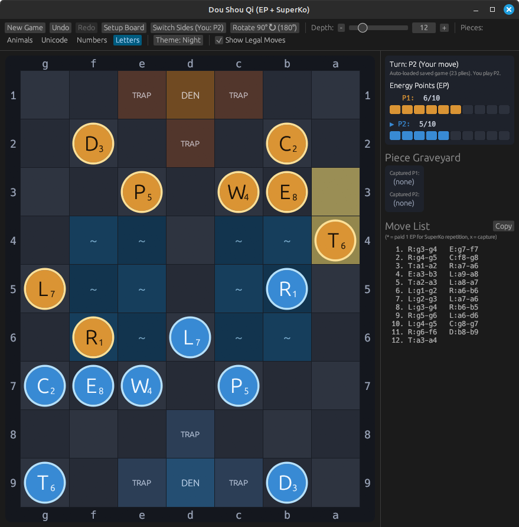

# ep-dsq
Dou Shou Qi (Jungle "chess") with energy points. Written in Rust 1.87, tested on Linux Mint 21.3

The goal of the game is, to reach the opponent's den with one of your pieces or to capture all their pieces.
Ranking of pieces: Elephant > Lion > Tiger > Panther > Wolf > Dog > Cat > Rat > Elephant

Yep, the rat can defeat the mighty elephant, but not vice versa!  (except if trapped)

Own pieces in opponent's traps get their strength reduced to *zero*. Only the rat can enter water, blocking jumps of lions & tigers. It can only capture from land-to-land or from water-to-water.

This variant specialty is an energy-system: Attacking yields you energy and repeating a position consumes it. You can't repeat a position if you have no energy.
If a player has no legal moves left, they lose the game.

(The [zip-included] file "dsq_engine" is the ready compiled GUI-app with the current engine included, using -O3 optimization and "fat LTO" (link-time optimizer), with symbols stripped to minimize filesize. Tested on Linux Mint 21.3)

Have fun!  :)

[ More info in Discord: https://discord.gg/257jDH3nmn ]
