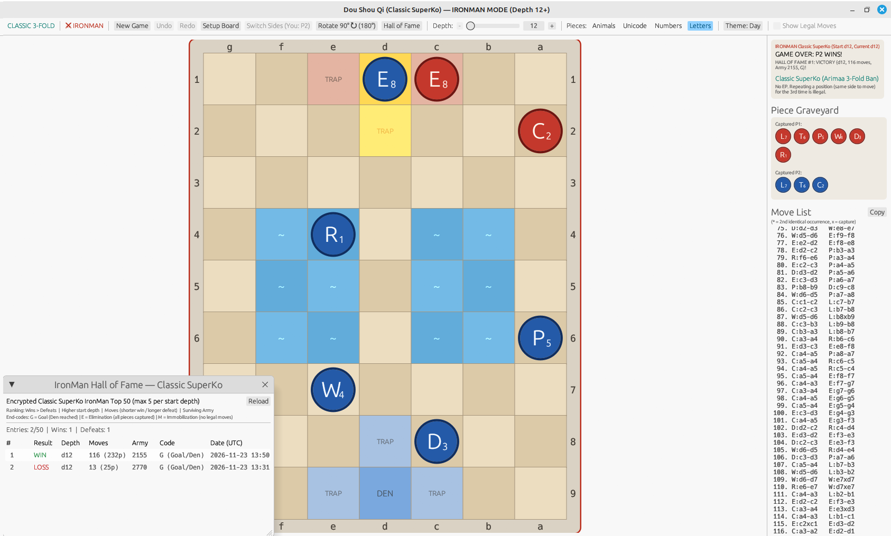

# ep-dsq
Dou Shou Qi (Jungle "chess") with energy points. Written in Rust 1.87, tested on Linux Mint 21.3

The goal of the game is, to reach the opponent's den with one of your pieces or to capture all their pieces.
Ranking of pieces: Elephant > Lion > Tiger > Panther > Wolf > Dog > Cat > Rat > Elephant

Yep, the rat can defeat the mighty elephant, but not vice versa!  (except if trapped)

Own pieces in opponent's traps get their strength reduced to *zero*. Only the rat can enter water, blocking jumps of lions & tigers. It can only capture from land-to-land or from water-to-water.

This variant specialty is an energy-system: Attacking yields you energy and repeating a position consumes it. You can't repeat a position if you have no energy.
If a player has no legal moves left, they lose the game.

(The [zip-included] file "dsq_engine" is the ready compiled GUI-app with the current engine included, using -O3 optimization and "fat LTO" (link-time optimizer), with symbols stripped to minimize filesize. Tested on Linux Mint 21.3)

Have fun!  :)

--
UPDATE:
IronMan mode added. Start app with argument "-- ironman [depth]". Depth must be a number >= 12. The app automatically stores statistics in a datafile, in "$HOME/.local/share/dsq_engine/", where also the savefile is.

UPDATE2:
Classic SuperKo mode and accompanying IronMan mode added.

Start app with this string (using cargo, in source-mode) "cargo run --dist -- help"  OR  (if using the binary) "dsq_engine -h", to get a list of all available parameters.
In both IronMan modes, saving a game is not possible.

The new IronMan mode in action:

Update 3 (r5):
Unified & streamlined the highscore table. Maximum 50 entries in whole. Max.5 entries per depth.

Update 4 (r6):
Improved the eval (added new term about piece-cornering)

Update 5 (r7):
added a 'show thinking'-mode and a stop-button (both greyed out in ironman-mode)

Update 6 (r8):
added a 5th piece-set: chinese (with tiny numbers as help)

Update 7 (r9):
added a time-per-move slider (for the engine); 
added function to save player's name in HoF (if eligible); 
added new start-parameter "import", to allow players to load previous game-logs (human-readable textfiles, containing copied movelists), this now allows to analyze previous ironman-games; 
updated the help-text (invoked with "dsq_engine -h"); 
added a win64-executable (also fat-LTO built)

[ More info in Discord: https://discord.gg/257jDH3nmn ]

